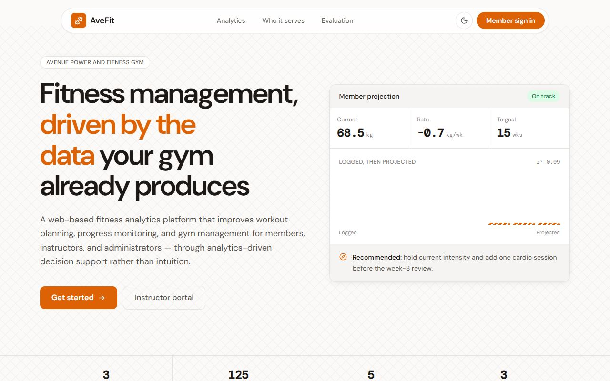
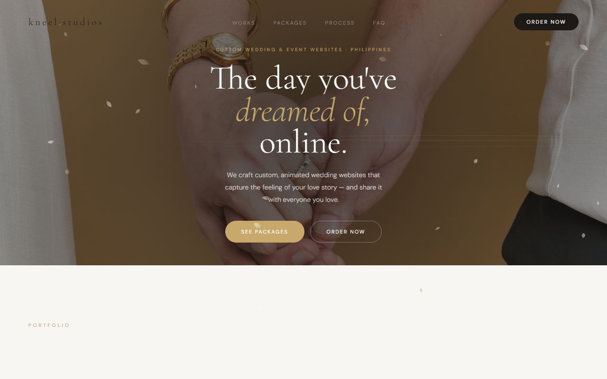

<picture>
  <source media="(prefers-color-scheme: dark)" srcset="header-dark.svg" />
  <source media="(prefers-color-scheme: light)" srcset="header-light.svg" />
  
</picture>

  

 

## Now

**Full-Stack Developer · Malaya Villas** (Aug 2026 – present)

I took over Malaya's operations system as an early prototype and now build and run it in production: the guest booking site at **[malayavillas.com](https://www.malayavillas.com)**, and the admin the owner and the reservations team work in every day. I ship the features, the database changes and the deploys, and I support the staff who use it.

On the side I build booking systems and websites for small businesses in the Philippines.

## Featured Work

### Malaya OBS — booking & operations system &nbsp;·&nbsp; [Live ↗](https://www.malayavillas.com)

A guest website and a full operations admin for a 10-villa short-term rental business in Cavite and Tagaytay, live since September 2026.

- **Guests** search villas, book and pay online (Xendit: GCash and cards), and manage their stays, messages and reviews from their own account
- **Airbnb calendar sync**: Airbnb bookings block the same nights on the site, so a villa is never booked twice
- **Reservations team**: shared inbox with quick replies, booking calendar and pricing, payment verification, and a CSR performance leaderboard
- **Owner**: finance built to match his own workbooks (P&L, receivables, payables, cash position, forecast), plus portals for caretakers and investors
- **Maya**, an in-app AI assistant built on the Claude API

`TanStack Start` `React` `TypeScript` `Supabase · Postgres · RLS · Realtime` `Vercel` `Resend` `Xendit`
Client codebase, so the repository is private.

 

<table>
  <tr>
    <td width="50%" valign="top">
      
      <h3>Vivienda</h3>
      FREELANCE · RESORT BOOKING SYSTEM
      
Booking site and admin for a private-pool resort in Alitagtag, Batangas. Guests book, pay by GCash or bank transfer, and chat with the resort from their own account. The owner runs bookings, the calendar, guests, reviews and finances from one admin.

      
<code>React</code> <code>TypeScript</code> <code>Supabase</code> <code>Resend</code>

      <a href="https://vivienda-rho.vercel.app/">Live ↗</a> · <a href="https://github.com/clarenceneilmeneses/vivienda">Code</a>
    </td>
    <td width="50%" valign="top">
      
      <h3>AveFit</h3>
      CAPSTONE · FITNESS ANALYTICS
      
Fitness analytics and gym management for Avenue Power and Fitness Gym. It serves members, instructors and administrators with descriptive, predictive and prescriptive analytics, from progress projections to workout recommendations.

      
<code>React 19</code> <code>Express 5</code> <code>PostgreSQL</code> <code>Chart.js</code>

      <a href="https://avefit-capstone.vercel.app/">Live ↗</a> · <a href="https://github.com/clarenceneilmeneses/avefit-capstone">Code</a>
    </td>
  </tr>
  <tr>
    <td width="50%" valign="top">
      
      <h3>PapaFix</h3>
      STARTUP · ON-DEMAND HOME REPAIR
      
Batangas' on-demand aircon service app. I built the landing page, the customer app UI reference, and the admin console with live technician tracking, booking and payment oversight, and cross-filtering analytics. Aggregation runs in Postgres functions, and the audit trail is enforced by triggers under RLS.

      
<code>React</code> <code>Supabase</code> <code>PostgreSQL</code> <code>Leaflet</code>

      <a href="https://papafix-landing.vercel.app/">Live ↗</a> · <a href="https://github.com/clarenceneilmeneses/papafix-ui">UI reference</a>
    </td>
    <td width="50%" valign="top">
      
      <h3>Kneel Studios</h3>
      STUDIO · WEDDING &amp; EVENT WEBSITES
      
A studio for custom, animated wedding and event websites, with packages, sample sites and ordering. Also in this line of work: <a href="https://wedding-two-gules.vercel.app/">Leomar &amp; Elizabeth's wedding site</a> and <a href="https://tesla-pi-drab.vercel.app/">Grand Arrival Bridal Car</a>.

      
<code>HTML</code> <code>CSS</code> <code>JavaScript</code> <code>Animation</code>

      <a href="https://kneelstudios.vercel.app/">Live ↗</a> · <a href="https://github.com/clarenceneilmeneses/kneelstudios">Code</a>
    </td>
  </tr>
</table>

### More systems

| Project | What it is | Stack |
|---|---|---|
| **NAM Sales & Inventory Platform** | Internship: a building-supply company's first sales platform, replacing spreadsheets. It runs **₱1M+ in monthly sales operations** and turned a week of report compilation into on-demand dashboards. I later moved it from PHP/MySQL to React on Postgres myself, without losing a record. [Original version](https://github.com/clarenceneilmeneses/sales_dashboard) | React · TypeScript · Supabase · Vitest |
| **[PDAO Client Management Portal](https://github.com/clarenceneilmeneses/pwd-portal)** | Sole developer, under an agreement with the City of Sto. Tomas: records, appointments and ID applications for a PWD affairs office serving ~4,000 residents, with a GIS map of all 30 barangays. | PHP · MySQL · Leaflet |
| **[Lexus Industrial](https://github.com/clarenceneilmeneses/lexus)** | Product catalog website for a building-materials supplier, with a role-secured CMS so staff manage products and inquiries themselves. | React · TypeScript · Supabase |
| **[Batangas Youth Civic Hub](https://github.com/clarenceneilmeneses/civic)** | An e-civic hub helping Batangas City youth follow local government activities, with a built-in CMS. Research initiative with the University of Batangas. | Next.js 14 · Supabase · Tiptap |
| **[Daydream](https://github.com/clarenceneilmeneses/daydream)** | Platform for an emotional-regulation study: assessment, scored results, a community forum and a researcher admin. | React · TypeScript · Supabase · Recharts |
| **[Antiguo Store](https://github.com/clarenceneilmeneses/clothing)** | Streetwear storefront with customer accounts, cart, size charts and shipping rates, plus a store admin. | React · Supabase |
| **[Material Balance Calculator](https://material-eqtn.vercel.app/)** | Commissioned tool for petroleum engineering students at BatStateU Alangilan. | JavaScript |
| **[Portfolio & CMS](https://github.com/clarenceneilmeneses/advanced-portfolio)** | My portfolio as a content-managed site: every section is editable from a private admin, with no redeploy. | Next.js · Supabase |

## About

BS Information Technology, Major in Business Analytics, Batangas State University, Class of 2026. Google-certified in Analytics and Ads Measurement.

I like the whole length of a system: the schema, the screens people use all day, the deploy, and the dashboard that tells the owner whether it's working.

## Tech Stack

      
 
     
 
     

## GitHub Activity

  
  

 

  Open to freelance projects and full-stack roles · Batangas / Remote

