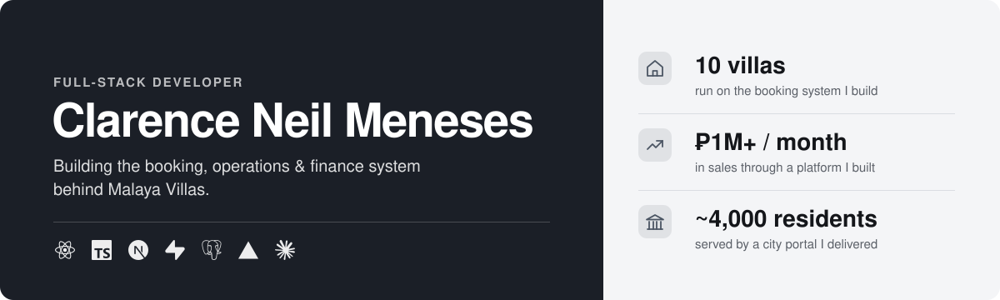
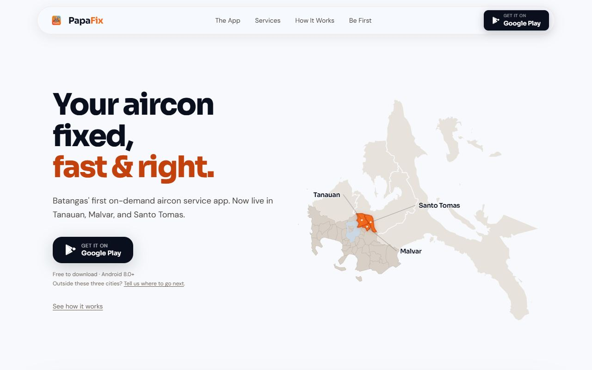

<picture>
  <source media="(prefers-color-scheme: dark)" srcset="header-dark.svg" />
  <source media="(prefers-color-scheme: light)" srcset="header-light.svg" />
  
</picture>

 

  &nbsp;
  &nbsp;
  

## Building now: Malaya OBS

**Full-Stack Developer, Malaya Villas** · Aug 2026 – present · [malayavillas.com](https://www.malayavillas.com)

The booking and operations system for a 10-villa rental business in Cavite and Tagaytay. I took it over as a prototype and now build and run it in production: guests book on the website, and the owner and reservations team run the business from the admin every day.

- **Online booking and payments:** guest accounts, GCash and card payments through Xendit, receipts and reminders by email
- **Airbnb calendar sync:** Airbnb bookings close the same nights on the site, so no villa is double-booked
- **Reservations desk:** one inbox for every guest thread, booking calendar and pricing, payment verification, staff performance rankings
- **Finance:** P&L, receivables, payables, cash position and forecast, matched to the owner's own workbooks
- **Portals** for caretakers and investors, and an in-app assistant built on the Claude API

         
Client code, so the repository is private.

## Other systems I've built

<table>
  <tr>
    <td width="50%" valign="top">
      
       
      <b>Vivienda</b> · freelance 
      Booking system for a private-pool resort in Alitagtag, Batangas. Guests book, pay by GCash or bank transfer and chat with the resort from their own account. The owner runs bookings, the calendar, guests, reviews and finances from one admin.
        
          
      <a href="https://vivienda-rho.vercel.app/">Live site</a> · <a href="https://github.com/clarenceneilmeneses/vivienda">Code</a>
    </td>
    <td width="50%" valign="top">
      
       
      <b>PapaFix</b> · on-demand home repair, Batangas 
      Admin console for an aircon-service app: live technician tracking on a map, booking and payment oversight, and analytics that filter on click. Totals are computed in Postgres functions, and every change lands in an audit trail enforced by database triggers.
        
          
      <a href="https://papafix-landing.vercel.app/">Live site</a> · <a href="https://github.com/clarenceneilmeneses/papafix-ui">App UI reference</a>
    </td>
  </tr>
</table>

| System | What it does |
|---|---|
| **NAM Sales & Inventory Platform** Internship     | A building-supply company's first sales system, replacing spreadsheets: quotations, sales, inventory, finance and logistics. It runs **₱1M+ in monthly sales**, and reports that took a week to compile are now on-demand dashboards. I later moved it from PHP/MySQL to Postgres myself without losing a record. [First version](https://github.com/clarenceneilmeneses/sales_dashboard) |
| **[PDAO Client Management Portal](https://github.com/clarenceneilmeneses/pwd-portal)** City of Sto. Tomas    | As sole developer under a memorandum of agreement: records, appointments and ID applications for the city's PWD affairs office, serving ~4,000 residents, with a GIS map of all 30 barangays. |
| **[Material Balance Calculator](https://material-eqtn.vercel.app/)** Commission  | A calculator for petroleum engineering students at BatStateU Alangilan. |
| **[Portfolio & CMS](https://github.com/clarenceneilmeneses/advanced-portfolio)**   | My portfolio as a content-managed site: every section is edited from a private admin, with no redeploy. |

## Background

BS Information Technology, major in Business Analytics, Batangas State University, Class of 2026. Google-certified in Analytics and Ads Measurement.

<picture>
  <source media="(prefers-color-scheme: dark)" srcset="stack-dark.svg" />
  <source media="(prefers-color-scheme: light)" srcset="stack-light.svg" />
  
</picture>
